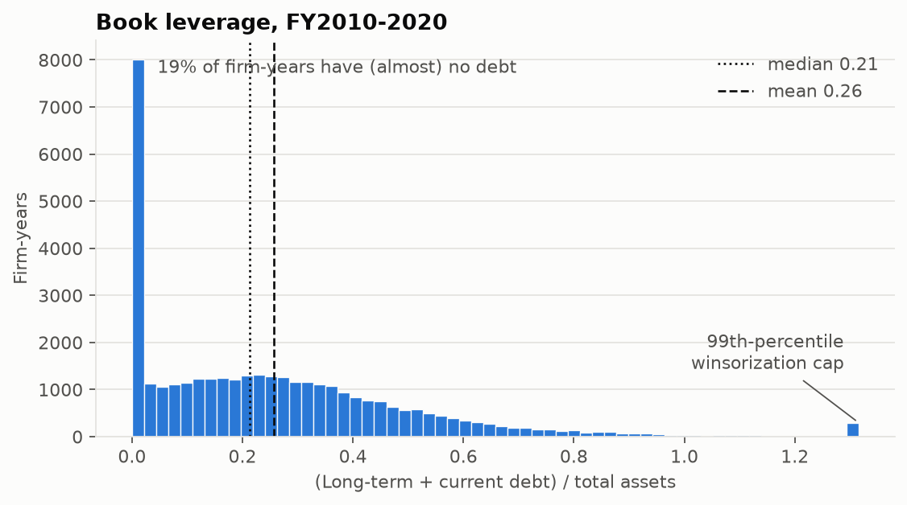
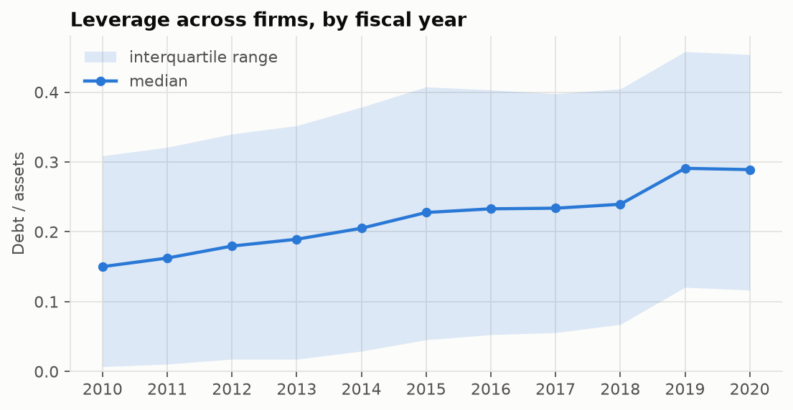
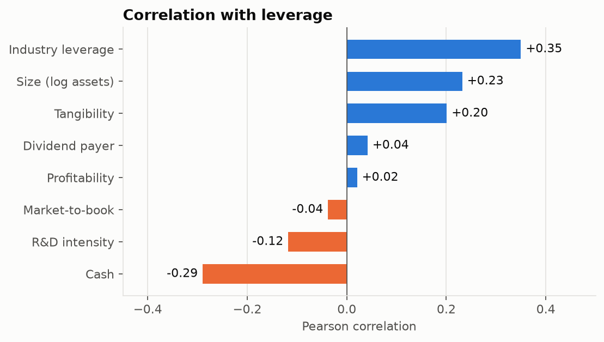
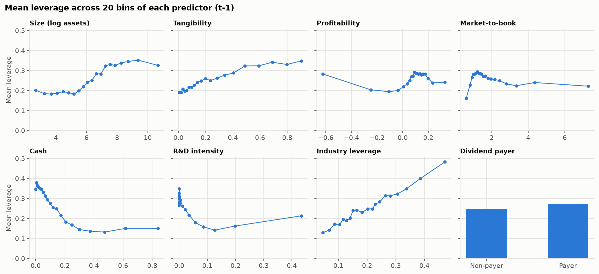
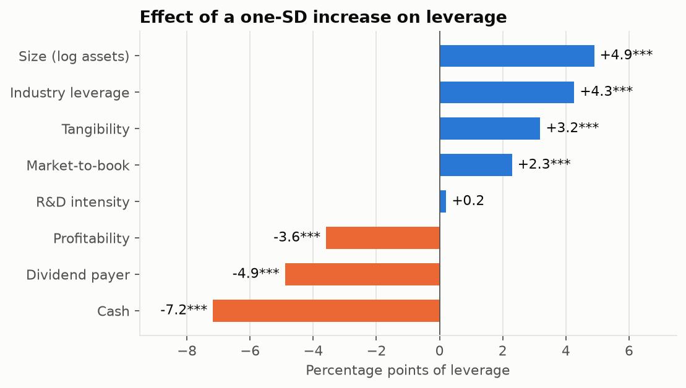

# The Determinants of Capital Structure

**James Huang** · Fordham University, MS Quantitative Finance · Machine Learning & Econometrics, Take-Home Assignment, Part 1

> *Assignment.* Download annual information on North American companies from WRDS for 2010–2020,
> including the debt ratio and other variables that determine corporate performance. (1) Clean and
> describe the database, describe the variables, present summary statistics for each variable, and
> illustrate the distribution of the outcome. (2) Show the correlation between the outcome and the
> predictors. (3) Write down and explain a linear model of the debt ratio, estimate it by OLS,
> identify the important factors, interpret the coefficients and report the R-squared.

## Summary

- **Data.** 36,718 firm-years for 5,822 US and Canadian non-financial firms, FY2010–2020.
- **Determinants.** Larger firms, firms with more tangible assets and firms in high-leverage
  industries carry more debt. Profitable, cash-rich and dividend-paying firms carry less.
- **Fit.** OLS explains **21.4%** of the variation in the debt ratio, and **24.8%** with industry
  and year effects.

---

## Question 1. The database: cleaning, variables and summary statistics

### 1.1 What kind of database is it?

- **Source.** **Compustat North America Fundamentals Annual** (`comp.funda`), accessed through Wharton
  Research Data Services. The data are pulled in code using the WRDS Python API, with Compustat's
  standard screens: industrial format, standardized data, domestic population and consolidated
  statements.
- **Structure.** The data form an **unbalanced panel**: each row is one firm (identified by `gvkey`) in one
  fiscal year. Firms enter and leave as they list, merge or delist, so the average firm appears in
  6.3 of the 11 years.

### 1.2 How was it cleaned, and how many observations remain?

| Step | Firm-years left | Why |
|---|---:|---|
| Compustat records, FY2009–2020 | 136,665 | FY2009 is kept only to build lagged predictors |
| Incorporated in the US or Canada | 123,808 | Assignment asks for North American companies |
| Drop financials (SIC 6000–6999) and utilities (SIC 4900–4949) | 70,523 | Debt is part of a bank's business model, and utility leverage is set by regulators |
| Total assets ≥ $10M, positive sales, debt items reported | 48,070 | Micro-firms have a mean debt ratio of 9.8, a shell-company artifact |
| Prior-year data available (one-year lag) | 40,283 | Every predictor is measured at *t − 1* |
| **FY2010–2020, complete cases** | **36,718** | **Final estimation sample, 5,822 firms** |

Further cleaning steps:

- **No duplicate firm-years** exist, so the panel index (`gvkey`, `fyear`) is unique.
- **R&D** is missing for 44% of firm-years, mostly outside R&D-intensive industries, so a blank
  means "no material R&D". It is set to 0, with a `rd_missing` flag.
- **Market-to-book** cannot be computed without a share price (9% of rows). These rows are dropped
  rather than imputed.
- **Outliers.** All ratios, *including the debt ratio*, are winsorized at the 1st and 99th
  percentiles. Before winsorizing, market-to-book reached 29,351 and profitability −6.3.
- **Sanity check.** Apple's FY2020 values match its 10-K: debt ratio 0.38, EBITDA/assets 0.23 and
  cash/assets 0.28.

### 1.3 The variables

| Variable | Compustat definition | Expected sign | Economic rationale |
|---|---|:---:|---|
| **Debt ratio** (outcome) | (DLTT + DLC) / AT | | Share of assets financed with debt |
| Size | log(AT) | + | Larger firms are diversified and face lower distress costs (trade-off theory) |
| Tangibility | PPENT / AT | + | Fixed assets can be pledged as collateral |
| Profitability | OIBDP / AT | − | Profitable firms use retained earnings first (pecking-order theory) |
| Market-to-book | (AT − CEQ + CSHO × PRCC_F) / AT | − | Growth options lose value in distress |
| Cash | CHE / AT | − | Liquid assets substitute for borrowing |
| R&D intensity | XRD / AT | − | Intangible investment supports little debt |
| Dividend payer | 1 if DVC > 0 | − | Mature firms with good access to internal funds |
| Industry leverage | Median debt ratio of the 2-digit SIC industry-year | + | Industry-wide debt capacity and norms |

Controls are the `rd_missing` flag and a flag for firms reporting in Canadian dollars.

### 1.4 Summary statistics

| Variable | N | Mean | SD | Min | 25% | Median | 75% | Max |
|---|---:|---:|---:|---:|---:|---:|---:|---:|
| **Debt ratio** | 36,718 | 0.257 | 0.247 | 0.000 | 0.044 | 0.214 | 0.384 | 1.315 |
| Size (log assets) | 36,718 | 6.255 | 2.075 | 2.303 | 4.661 | 6.204 | 7.702 | 13.614 |
| Tangibility | 36,718 | 0.285 | 0.268 | 0.001 | 0.069 | 0.183 | 0.444 | 0.944 |
| Profitability | 36,718 | 0.052 | 0.203 | −0.996 | 0.023 | 0.097 | 0.151 | 0.403 |
| Market-to-book | 36,718 | 2.012 | 1.560 | 0.471 | 1.107 | 1.500 | 2.289 | 10.107 |
| Cash | 36,718 | 0.195 | 0.222 | 0.000 | 0.035 | 0.109 | 0.272 | 0.939 |
| R&D intensity | 36,718 | 0.049 | 0.107 | 0.000 | 0.000 | 0.000 | 0.045 | 0.680 |
| Dividend payer | 36,718 | 0.356 | 0.479 | 0 | 0 | 0 | 1 | 1 |
| Industry leverage | 36,718 | 0.206 | 0.109 | 0.000 | 0.121 | 0.196 | 0.273 | 0.945 |

- **Typical firm.** The median firm has about $500M of assets (e^6.2), finances 21% of them with
  debt, and holds 11% in cash.
- **Profitability.** Median EBITDA is 10% of assets. The mean is only 5% because a tail of
  loss-makers pulls it down.
- **Dividends.** About a third of firms pay dividends.

### 1.5 Distribution of the outcome

The debt ratio is right-skewed, with a median of 0.21 and a mean of 0.26.

- **No debt.** 19% of firm-years carry essentially no debt, a well-known group of young, cash-rich
  and R&D-intensive firms.
- **Negative equity.** A small mass sits at the winsorization cap of 1.31: firms whose debt exceeds
  their book assets.

The median debt ratio rose from 0.15 in 2010 to 0.29 in 2019–2020. The step in 2019 coincides with
new lease-accounting rules that brought leases onto balance sheets. Shifts like this affect all
firms at once, which is why the model includes year effects.

---

## Question 2. Correlation between the debt ratio and the predictors

| | Industry leverage | Size | Tangibility | Dividend payer | Profitability | Market-to-book | R&D intensity | Cash |
|---|---:|---:|---:|---:|---:|---:|---:|---:|
| **Correlation with debt ratio** | +0.35 | +0.23 | +0.20 | +0.04 | +0.02 | −0.04 | −0.12 | −0.29 |

**Correlations with the debt ratio.**

- **Positive:** industry leverage, size and tangibility. Firms borrow more when their industry
  does, when they are large, and when they have collateral.
- **Negative:** cash and R&D intensity.
- **Near zero:** profitability. The relationship is U-shaped (below), and profitable firms tend to be
  large (correlation 0.38), and size raises leverage. Only the regression can separate the two.

**Correlations among the predictors.** The largest is −0.62, between profitability and R&D intensity.
All variance inflation factors are below 2.3, far under the usual threshold of 10, so
multicollinearity is not a concern.

Each panel shows mean leverage in 20 equal-sized bins of a predictor.

- **Close to linear:** tangibility and industry leverage.
- **Strongly decreasing:** cash, until it reaches about 30% of assets.
- **Threshold:** size matters only above roughly $250M of assets.
- **Non-monotonic:** profitability.

---

## Question 3. A linear model of the debt ratio

### 3.1 Specification

$$
\begin{aligned}
\text{DebtRatio}_{it} = \;& \alpha + \beta_1\,\text{Size}_{i,t-1} + \beta_2\,\text{Tangibility}_{i,t-1} + \beta_3\,\text{Profitability}_{i,t-1} \\
& + \beta_4\,\text{MarketToBook}_{i,t-1} + \beta_5\,\text{Cash}_{i,t-1} + \beta_6\,\text{R\&D}_{i,t-1} \\
& + \beta_7\,\text{DividendPayer}_{i,t-1} + \beta_8\,\text{IndustryLeverage}_{i,t-1} \\
& + \gamma'\,\text{Controls}_{i,t-1} + \mu_j + \lambda_t + \varepsilon_{it}
\end{aligned}
$$

- ***i* and *t*** index firms and fiscal years.
- **Each β** is the change in the debt ratio from a one-unit change in that characteristic, holding the
  others fixed.
- **Lagged predictors.** They are measured at *t − 1*, so they are determined *before* the debt ratio
  they explain. This limits reverse causality, for example a debt issue that raises cash in the
  same year.
- **$\mu_j$ and $\lambda_t$** are industry (2-digit SIC) and year effects. They absorb industry norms
  and economy-wide shocks.

The model is estimated by **OLS** in three versions:

1. **Pooled OLS**, without $\mu_j$ and $\lambda_t$.
2. **OLS with industry and year dummies.** This is the preferred specification.
3. **Firm and year fixed effects.** A robustness check that uses only changes within each firm over
   time.

Because each firm appears in several years, standard errors are **clustered by firm**.

### 3.2 Estimates

| | (1) Pooled OLS | (2) + Industry & year | (3) Firm & year FE |
|---|---:|---:|---:|
| Size | 0.0224*** (0.0015) | 0.0236*** (0.0014) | 0.0211*** (0.0046) |
| Tangibility | 0.0342*** (0.0127) | 0.1190*** (0.0178) | 0.1166*** (0.0263) |
| Profitability | −0.1697*** (0.0173) | −0.1775*** (0.0170) | −0.0979*** (0.0181) |
| Market-to-book | 0.0166*** (0.0021) | 0.0147*** (0.0020) | −0.0004 (0.0019) |
| Cash | −0.3134*** (0.0152) | −0.3238*** (0.0156) | −0.1323*** (0.0169) |
| R&D intensity | 0.0999*** (0.0380) | 0.0198 (0.0382) | −0.0396 (0.0490) |
| Dividend payer | −0.0471*** (0.0056) | −0.0490*** (0.0056) | 0.0004 (0.0053) |
| Industry leverage | 0.5902*** (0.0289) | 0.3911*** (0.0384) | 0.2868*** (0.0350) |
| **R²** | **0.214** | **0.248** | **0.034** (within) |
| Observations | 36,718 | 36,718 | 36,718 |

Firm-clustered standard errors are in parentheses. \*\*\* p < 0.01. All specifications include the
R&D-missing and Canadian-dollar controls. In (3), the Canadian-dollar flag is absorbed by the firm
effects.

### 3.3 How to interpret the coefficients

These interpretations use specification (2). The debt ratio is a fraction, so a coefficient of
0.10 means 10 percentage points (pp).

| Variable | Coefficient | Reading |
|---|---:|---|
| Size | +0.024 | Doubling total assets raises the debt ratio by **1.6 pp** (0.024 × ln 2) |
| Tangibility | +0.119 | 10 pp more of assets in PP&E → debt ratio **+1.2 pp** |
| Profitability | −0.178 | EBITDA/assets 10 pp higher → debt ratio **−1.8 pp** |
| Market-to-book | +0.015 | Market value one times book assets higher → debt ratio **+1.5 pp** |
| Cash | −0.324 | 10 pp more of assets in cash → debt ratio **−3.2 pp** |
| R&D intensity | +0.020 | Not significant once industry is controlled for |
| Dividend payer | −0.049 | Payers have a debt ratio **4.9 pp lower** than comparable non-payers |
| Industry leverage | +0.391 | Industry median 10 pp higher → firm's debt ratio **+3.9 pp** |

### 3.4 Which factors matter most?

The units differ, so the chart compares the effect of a **one-standard-deviation** increase in each
predictor.

1. **Cash (−7.2 pp per SD)** has the largest effect. Firms with liquid assets need less external
   finance.
2. **Size (+4.9 pp)** supports the trade-off theory: large firms have more stable cash flows and lower
   expected bankruptcy costs.
3. **Dividend payers (−4.9 pp)** are mature firms that fund themselves internally. In the raw data
   payers look slightly *more* levered, because they are large. The regression removes this
   confounding.
4. **Industry leverage (+4.3 pp)** and **tangibility (+3.2 pp)**. Industry norms and collateral both
   matter.
5. **Profitability (−3.6 pp)** supports the **pecking-order theory**: profitable firms use retained
   earnings instead of borrowing. It contradicts the simple trade-off prediction.

Two results do not match theory:

- **Market-to-book (+2.3 pp)** has the opposite sign in pooled data and disappears within firms (3).
  A likely reason is that firms with depressed or negative book equity mechanically have both high
  debt ratios and high market-to-book.
- **R&D intensity** loses significance once industries are compared like for like.

**Robustness (3).** Size, tangibility, profitability, cash and industry leverage keep their signs and
significance with firm fixed effects. The firm effects are jointly significant (F = 14.6,
p < 0.001).

### 3.5 What is the R-squared?

- **Pooled OLS:** R² is **0.214**, so the characteristics explain 21% of the variation in debt ratios
  across firm-years. The F-statistic of 236 (p < 0.001) rejects the hypothesis that all slopes are
  zero.
- **With industry and year dummies:** R² rises to **0.248**.
- **Firm fixed effects:** the *within* R² is 0.034. Year-to-year changes in a firm's characteristics
  explain little of its year-to-year changes in leverage.

This is a well-documented feature of capital structure: debt ratios are highly persistent, and most
of their variation is a stable firm-specific component (Lemmon, Roberts & Zender 2008). The pooled
R² captures the differences *between* firms that the fixed effects absorb.

### 3.6 Limitations

- **Association, not causation.** The estimates are conditional associations, not causal effects.
  Lagging the predictors limits simultaneity but not omitted-variable bias.
- **Bounded outcome.** The debt ratio cannot fall below zero, and 1.8% of fitted values do. A
  fractional-response model would respect the bound. The linear model fits well across the middle
  of the distribution.
- **Scope.** Results apply to non-financial firms with at least $10M of assets.

---

*Full code, including every cleaning step:* [`notebooks/01_capital_structure.ipynb`](../notebooks/01_capital_structure.ipynb)

**References.**

- Frank, M. & Goyal, V. (2009). Capital structure decisions: Which factors are reliably important? *Financial Management* 38(1).
- Lemmon, M., Roberts, M. & Zender, J. (2008). Back to the beginning: Persistence and the cross-section of corporate capital structure. *Journal of Finance* 63(4).
- Rajan, R. & Zingales, L. (1995). What do we know about capital structure? Some evidence from international data. *Journal of Finance* 50(5).
