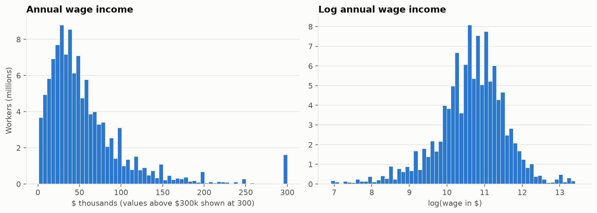
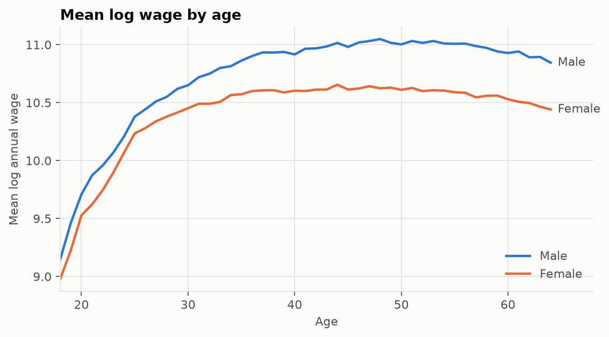
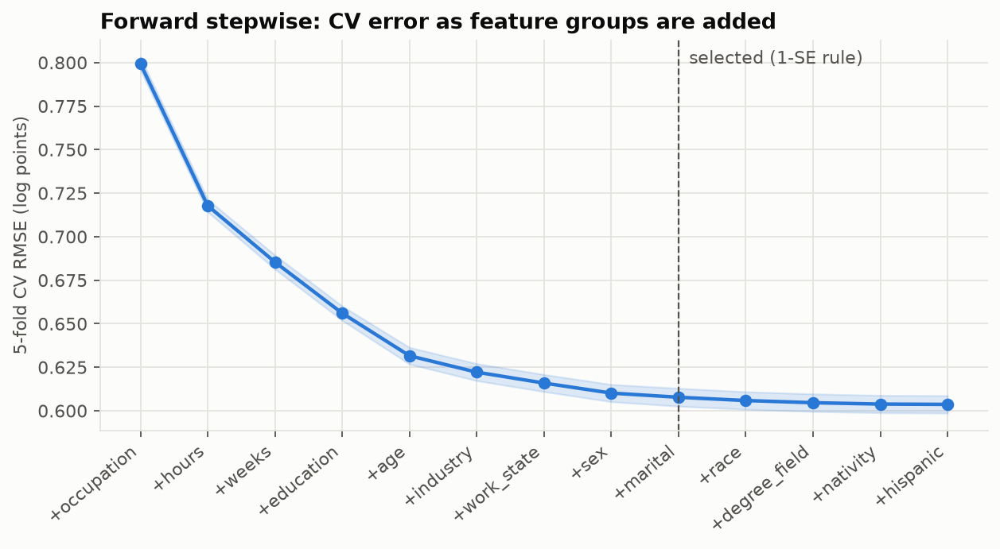
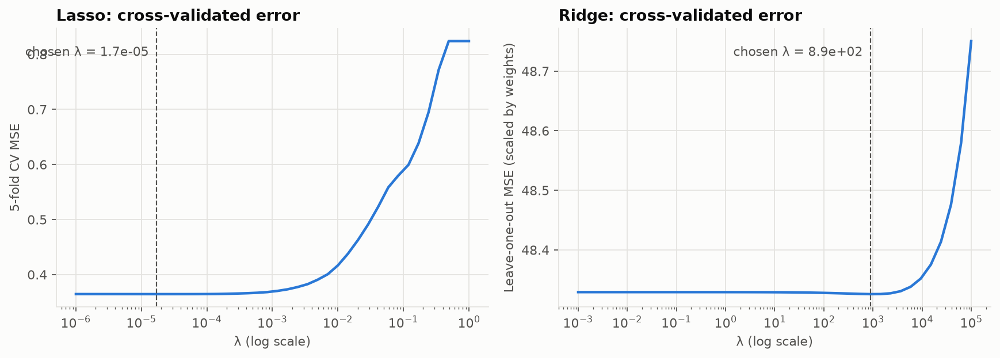
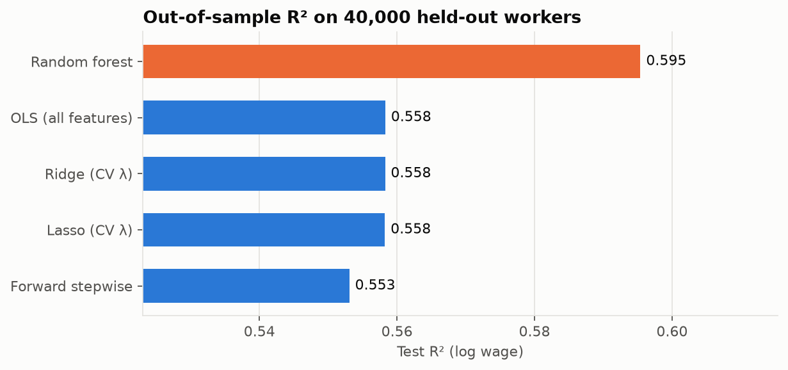
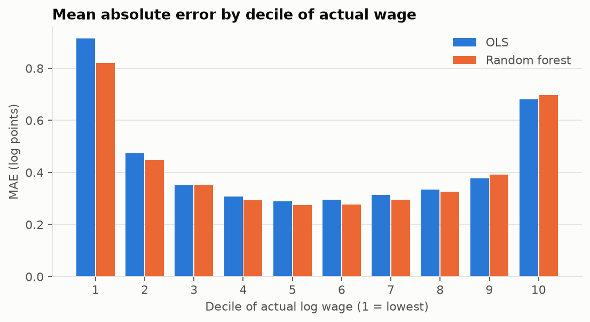
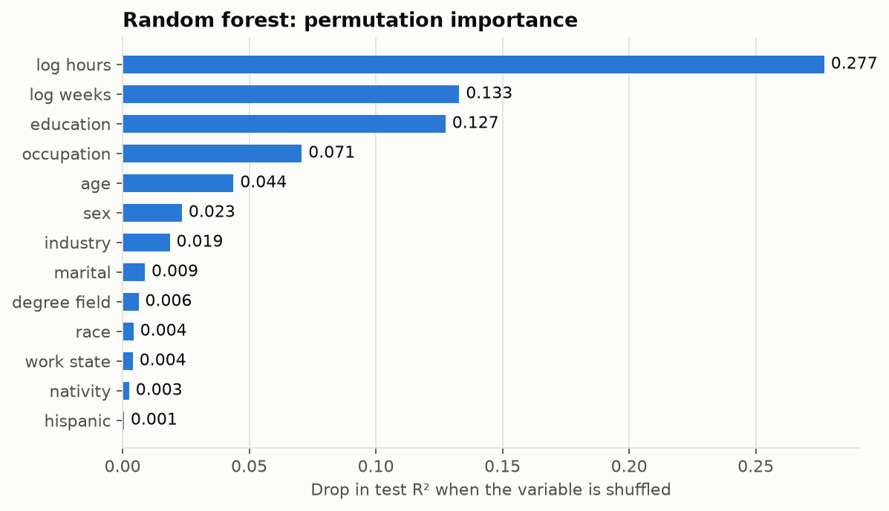

# Predicting Wages

**James Huang** · Fordham University, MS Quantitative Finance · Machine Learning & Econometrics, Take-Home Assignment, Part 2

> *Assignment.* Collect information from IPUMS USA, selecting the 2020 ACS sample, on wages and
> other individual characteristics. Use it to build a model that predicts an individual's wage.
> Start with a simple linear model including all the variables you believe are important. Then
> use Stepwise Selection, Lasso, Ridge and Random Forest (with the best λ for Ridge and Lasso
> chosen by cross-validation). Comment on the differences between these approaches and pick the
> best model.

## Summary

- **Best model.** The **Random Forest** predicts wages best, with an out-of-sample R² of **0.595**
  against **0.558** for the simple linear model.
- **Lasso and Ridge** do not improve on the linear model: with 160,000 training observations and
  154 features, cross-validation picks an essentially zero penalty.
- **Stepwise selection** reaches almost the same accuracy with 9 of the 13 variable groups.
- **Key predictors.** Hours, weeks worked, education and occupation matter most.

---

## 1. Data: the 2020 ACS from IPUMS USA

### 1.1 Collection

The extract was requested in code through the **IPUMS API**, using the 2020 ACS 1-year sample
(`us2020a`). It contains wage and salary income (`INCWAGE`) plus the characteristics below.

For 2020, IPUMS recommends the **experimental person weight** (`EXPWTP`), which the Census Bureau
built to correct for pandemic-era non-response. It is used in every summary statistic, model fit
and error metric.

| Group | IPUMS variables | Used as |
|---|---|---|
| Outcome | INCWAGE | log(annual wage and salary income) |
| Demographics | AGE, SEX, MARST, RACE, HISPAN, CITIZEN | age and age², sex, marital status (3), race (5), Hispanic origin, nativity (4) |
| Education | EDUCD, DEGFIELD | education level (8 groups), field of bachelor's degree (38) |
| Job | OCC, IND, PWSTATE2 | occupation (23 SOC major groups), industry (16 sectors), state of work |
| Labor supply | UHRSWORK, WKSWORK1 | log usual hours per week, log weeks worked |
| Sample filters | EMPSTAT, CLASSWKR, SCHOOL | employment status, class of worker, school enrollment |

### 1.2 Cleaning

| Step | People left | Why |
|---|---:|---|
| 2020 ACS person records | 2,641,054 | |
| Aged 18–64 | 1,570,074 | Working-age population |
| Employed | 1,084,059 | Wages are only observed for workers |
| Works for wages (excludes self-employed) | 982,275 | 52% of the self-employed report $0 of `INCWAGE`, because their pay is business income |
| Not enrolled in school | 880,312 | Student jobs reflect schooling, not worker characteristics |
| **Wage ≥ $1,000, positive hours and weeks** | **875,856** | Removes the N/A code 999999 and implausible wages (median $5.62/hour below $1,000) |

The final sample represents **116 million workers**.

- **Recoding.** Raw IPUMS codes were collapsed into the groups listed in 1.1. Every code maps to a
  group, and no values are missing.
- **Top-coding.** IPUMS caps the highest wages at a state-specific top code, between $200k and $743k.
  It affects 0.13% of workers.

### 1.3 Description

| Weighted statistic | Mean | Median | 10th pct | 90th pct |
|---|---:|---:|---:|---:|
| Annual wage income | $61,068 | $47,000 | $14,000 | $120,000 |
| Age | 41 | 43 | 26 | 60 |
| Usual hours per week | 41 | 40 | 30 | 50 |
| Weeks worked | 49 | 52 | 42 | 52 |

The sample is 53% men. About 40% hold at least a bachelor's degree, and 18% were born abroad.

Wages are strongly right-skewed: the mean is well above the median. The model therefore predicts
**log wages**. This makes the target roughly symmetric, and linear coefficients read as
approximate percentage differences.

**Age.** Earnings rise steeply in the 20s and peak around 45–50, which is why the linear models
include age².

**Sex.** The gap between men and women widens with age. Women earn 26% less than men on average
before any controls.

---

## 2. The starting point: a simple linear model

$$
\begin{aligned}
\log(\text{wage}_i) = \;& \beta_0 + \beta_1\,\text{age}_i + \beta_2\,\text{age}_i^2 + \beta_3 \log(\text{hours}_i) + \beta_4 \log(\text{weeks}_i) \\
& + \textstyle\sum_k \gamma_k\,D_{ik} + \varepsilon_i
\end{aligned}
$$

The $D_{ik}$ are dummies for sex, marital status, race, Hispanic origin, nativity, education,
degree field, occupation, industry and state of work, for **154 features** in total. Hours and
weeks enter in logs because annual wage = hourly rate × hours × weeks.

**Design.**

- **Sample.** All models use the same 200,000 randomly drawn workers: 160,000 for training and
  40,000 held out for testing.
- **Tuning.** Every tuning choice uses only the training set.
- **Evaluation.** Every model is scored once on the test set.

**Results.** The model explains **55.8%** of the variation in log wages out of sample. Training R²
is almost identical (0.560), so it does not overfit. Holding everything else equal:

| Characteristic | Effect on wages |
|---|---|
| Bachelor's degree (vs. no high-school diploma) | **+39%** |
| Master's degree | **+69%** |
| Doctorate / professional degree | **+103% / +107%** |
| Female (vs. otherwise identical male) | **−16.7%**, down from −26% before controls |
| +1% usual weekly hours | +0.88% annual wage |
| +1% weeks worked | +0.43% annual wage |

The education premia are much smaller than the raw differences in median pay (bachelor's $60k vs.
$28k without a diploma). Part of education's payoff works through *which occupation* a person
enters, and that channel is held constant here.

---

## 3. Stepwise selection, Lasso, Ridge and Random Forest

| Model | How it works | Tuning |
|---|---|---|
| **Forward stepwise** | Adds one variable group at a time (for example, all occupation dummies together), choosing the one that most lowers CV error | 5-fold CV; one-standard-error rule picks the size |
| **Lasso** | OLS plus an L1 penalty λΣ\|β\|; shrinks coefficients and can set them to exactly zero | **λ by 5-fold CV** over 40 values from 10⁻⁶ to 1 |
| **Ridge** | OLS plus an L2 penalty λΣβ²; shrinks all coefficients without removing any | **λ by leave-one-out CV** over 40 values from 10⁻³ to 10⁵ |
| **Random forest** | Average of 300 regression trees, each grown on a bootstrap sample | 30% of features per split, ≥ 20 workers per leaf |

### 3.1 Forward stepwise

Groups enter in the order **occupation → hours → weeks → education → age**. These five cut CV error
from 0.80 to 0.63. Industry, state, sex and marital status add a little more. Race, degree field,
nativity and Hispanic origin improve CV error by less than one standard error, so the
one-standard-error rule leaves them out. The selected model keeps **9 of 13 groups**, using 109
coefficients instead of 154.

### 3.2 Choosing λ for Lasso and Ridge

Both CV curves are flat for small λ and rise only when the penalty becomes large.

- **Lasso:** the best λ is **1.7 × 10⁻⁵**. It removes just 12 of 154 coefficients, all small
  degree-field and work-state categories.
- **Ridge:** the best λ is **≈ 890**. This looks large, but it is measured against a weighted sum of
  squared errors whose weights total about 20 million, so the shrinkage is negligible.

In both cases cross-validation is saying that **almost no regularization is needed**.

---

## 4. Comparison and choice of the best model

| Model | Test R² | Test RMSE | Test MAE | Median abs. error | Features |
|---|---:|---:|---:|---:|---:|
| **Random forest** | **0.595** | **0.579** | **0.420** | **30.0%** | 154 |
| Simple linear model (OLS) | 0.558 | 0.605 | 0.436 | 30.9% | 154 |
| Ridge (λ ≈ 890) | 0.558 | 0.605 | 0.436 | 30.9% | 154 |
| Lasso (λ = 1.7 × 10⁻⁵) | 0.558 | 0.605 | 0.436 | 30.9% | 142 non-zero |
| Forward stepwise | 0.553 | 0.609 | 0.440 | 31.1% | 109 |

All metrics are weighted and computed on the 40,000 held-out workers. RMSE and MAE are in log
points.

### 4.1 Differences between the approaches

- **Lasso and Ridge vs. OLS.** Penalized regression reduces variance at the cost of some bias. It
  helps when there are many predictors relative to observations, or when predictors are strongly
  collinear. Neither holds here: 160,000 observations for 154 features. Cross-validation therefore
  chooses near-zero penalties, and the three models are identical to three decimals.
- **Stepwise vs. OLS.** Stepwise trades a little accuracy (R² 0.553 vs. 0.558) for a simpler model.
  It shows that demographic variables add almost nothing once job, education and labor supply are
  known.
- **Random forest vs. the linear models.** The forest gains 3.7 points of R² because it captures
  **non-linearities and interactions** that the linear models omit. For example, the return to
  hours differs by occupation, and the education premium differs by industry.

The chart shows where those gains come from. The forest's advantage is concentrated among the
**lowest earners** (MAE 0.82 vs. 0.91 log points), where very low annual earnings come from
irregular part-year and part-time work that one linear slope cannot fit. It is slightly worse in
the top two deciles, because averaging within tree leaves pulls extreme predictions toward the
middle.

The forest relies mostly on **hours** (shuffling it lowers test R² by 0.28), then on **weeks** and
**education** (0.13 each), then on **occupation** and **age**.

### 4.2 The best model

**The Random Forest is the best model for predicting wages.** It has the lowest out-of-sample error
on every metric: R², RMSE, MAE and median percentage error. Its typical prediction is within about
30% of the actual wage.

The **simple linear model remains the best choice for explanation**. It is within four points of
R², and its coefficients have a direct economic reading, such as the education premia and the
gender gap. Lasso and Ridge add nothing over it here, and stepwise selection is the option if a
smaller model is wanted.

### 4.3 Limitations

- **Missing variables.** About 40% of the variation in log wages remains unexplained. Ability,
  experience, tenure and employer are not in the ACS.
- **Data quality.** Wages are top-coded, and 2020 earnings were disrupted by the pandemic.
- **Interpretation.** Coefficients and importance scores describe associations, not causal effects.

---

*Full code, including every cleaning step:* [`notebooks/02_wage_prediction.ipynb`](../notebooks/02_wage_prediction.ipynb)
